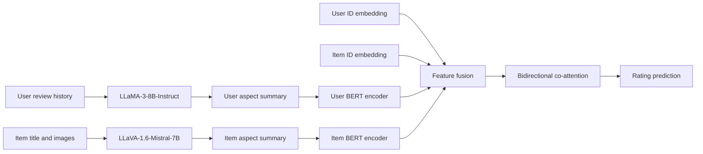

# MAS-Rec

Official research code archive for **MAS-Rec (Multimodal Aspect Summarization for Recommender Systems)**, a rating-prediction model that converts review text and product images into aligned aspect summaries before learning user-item preferences.

> This repository is being prepared as a private research and portfolio archive. Large processed datasets and trained checkpoints are intentionally excluded.

[한국어 README](README_KR.md) · [Paper](https://doi.org/10.1109/ACCESS.2026.3694258) · [Data guide](docs/DATA.md) · [Experiment map](docs/EXPERIMENTS.md)

## Research overview

Conventional multimodal recommenders often encode reviews and images independently, even though the two modalities describe the same product attributes in different forms. MAS-Rec first converts both modalities into aspect-centered natural-language summaries and then learns their interaction with a two-tower BERT model and bidirectional co-attention.



The BERT towers are not used only as frozen feature extractors. They are optimized jointly with the rating-prediction objective, allowing the language representations to adapt to recommendation.

## Main results

Performance reported in the paper (lower is better):

| Dataset | Model | MAE | MSE | RMSE | MAPE |
|---|---:|---:|---:|---:|---:|
| Clothing, Shoes and Jewelry | MAS-Rec | **0.316** | **0.257** | **0.507** | **0.089** |
| Cell Phones and Accessories | MAS-Rec | **0.299** | **0.278** | **0.527** | **0.090** |

Best-performing comparison models reported in the same experiments:

| Dataset | Comparison model | MAE | MSE | RMSE | MAPE |
|---|---:|---:|---:|---:|---:|
| Clothing, Shoes and Jewelry | MMCN | 0.386 | 0.302 | 0.549 | 0.108 |
| Cell Phones and Accessories | MMCN | 0.444 | 0.386 | 0.621 | 0.126 |

See [docs/EXPERIMENTS.md](docs/EXPERIMENTS.md) for the full baseline, fusion, encoder, and prompt-strategy tables.

## Repository structure

```text
MAS-Rec/
├── notebooks/
│   ├── 00_preprocessing/          # Filtering and BERT/RoBERTa/VGG16/ViT features
│   ├── 01_summarization/          # Text and image aspect summarization
│   ├── 02_model/                  # Proposed MAS-Rec model
│   ├── 03_baselines/              # NeuMF, ANR, AFRAM, MFNR, CAMRec, MMCN
│   └── 04_experiments/            # Fusion, prompt, and attention analyses
├── data/README.md                 # Local data placement
├── checkpoints/README.md          # Local checkpoint placement
├── docs/
│   ├── DATA.md
│   ├── EXPERIMENTS.md
│   └── REPRODUCIBILITY.md
├── requirements.txt
└── CITATION.cff
```

Notebook outputs and private runtime metadata have been removed. The original research notebooks used Google Colab and Google Drive, so legacy `/content/drive/MyDrive/...` paths remain in some cells. Configure those paths for your environment before running; see [docs/REPRODUCIBILITY.md](docs/REPRODUCIBILITY.md).

## Quick start

```bash
git clone https://github.com/hyun0415/MAS-Rec.git
cd MAS-Rec
python -m venv .venv
```

Activate the environment, install dependencies, and start Jupyter:

```bash
pip install -r requirements.txt
jupyter lab
```

Recommended execution order:

1. `notebooks/00_preprocessing/`
2. `notebooks/01_summarization/`
3. `notebooks/02_model/mas_rec.ipynb`
4. `notebooks/03_baselines/` and `notebooks/04_experiments/`

The LLaMA and LLaVA notebooks may require access-controlled Hugging Face models. Supply credentials through the `HF_TOKEN` environment variable or the hidden prompt in the notebook. Never commit a token.

## Datasets

Experiments use the Amazon review domains reported in the paper after filtering for review, image, and interaction availability.

| Dataset | Reviews | Users | Items | Sparsity |
|---|---:|---:|---:|---:|
| Clothing, Shoes and Jewelry | 66,718 | 7,449 | 16,099 | 99.944% |
| Cell Phones and Accessories | 23,491 | 4,149 | 4,975 | 99.886% |

Processed `.pkl` files are 63 MB–2.98 GB each and are not committed. Details are in [docs/DATA.md](docs/DATA.md).

## Citation

If this work is useful in your research, please cite:

```bibtex
@article{woo2026masrec,
  author  = {Soohyun Woo and Seonu Park and Xinzhe Li and Seongkook Lee and Jaekyeong Kim},
  title   = {Enhancing Multimodal Recommender System Performance Using Large Language Models},
  journal = {IEEE Access},
  volume  = {14},
  pages   = {75498--75514},
  year    = {2026},
  doi     = {10.1109/ACCESS.2026.3694258}
}
```

## License and usage

The article is distributed under CC BY 4.0. No separate open-source license has yet been granted for this code archive. Please contact the repository owner before reusing or redistributing the implementation.

