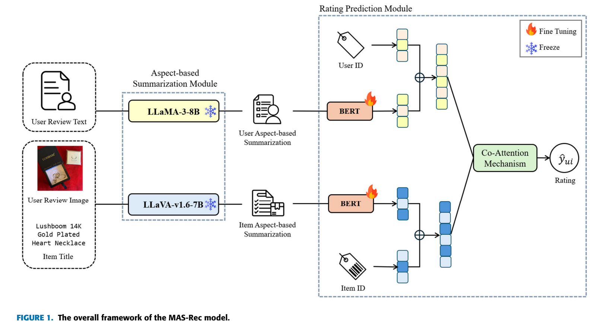
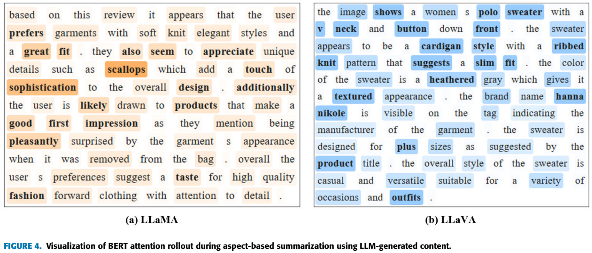

# MAS-Rec

MAS-Rec predicts a review rating from a user's review history and a product's
text and image information. Its main idea is simple: first describe both sides
with attribute-focused text, then learn which user preferences match the
product.

This repository is a research and portfolio archive. It does not include the
large processed datasets, model weights, or private credentials.

[한국어 설명](README_KR.md) · [Paper](https://doi.org/10.1109/ACCESS.2026.3694258) · [Data guide](data/README.md) · [Experiment notes](docs/EXPERIMENTS.md)

## 1. Problem

Reviews and product images often describe the same idea in different forms. A
review might say that a shirt is comfortable, while an image only shows its
shape, color, and material. When a recommender encodes these inputs separately,
it is harder to compare them directly.

MAS-Rec turns both inputs into short, attribute-focused text. This gives the
rating model a common language for user preferences and product features.

## 2. Data and label

The target is the 1-to-5 star rating in an Amazon review. The paper uses two
filtered product categories:

| Category | Reviews | Users | Items | Sparsity |
|---|---:|---:|---:|---:|
| Clothing, Shoes and Jewelry | 66,718 | 7,449 | 16,099 | 99.944% |
| Cell Phones and Accessories | 23,491 | 4,149 | 4,975 | 99.886% |

Sparsity means that most possible user-product pairs have no rating. This makes
preference learning difficult and increases the value of review content.

## 3. Method

The four model roles are:

- **LLaMA** summarizes review text into user preferences such as fit, style, or
  durability.
- **LLaVA** describes product images and titles with the same type of
  attribute-focused text.
- **BERT** encodes the two summaries. Its weights are fine-tuned for rating
  prediction; BERT is not used only as a frozen feature extractor.
- **Co-attention** combines the user and product representations before the
  final rating prediction.

The study uses existing LLMs to create attribute-level representations. It does
not claim to pretrain or develop a new LLM.



## 4. Experiment design

The paper uses a random 70% training, 10% validation, and 20% test split. Model
selection is based on validation performance, and the final test set is kept for
the last evaluation.

The archived notebooks were written at different stages of the research. They
use the same split ratios and seed, but each notebook creates its own split and
some training settings differ. The portfolio protocol fixes this by sharing one
split file and one metric implementation across every model. See
[the baseline audit](docs/BASELINE_AUDIT.md).

## 5. Main results

These are the values reported in the paper. They have not been rerun in this
portfolio refactor. Lower is better.

| Category | Best baseline RMSE | MAS-Rec RMSE | MAS-Rec MAE |
|---|---:|---:|---:|
| Clothing, Shoes and Jewelry | 0.549 (MMCN) | **0.507** | **0.316** |
| Cell Phones and Accessories | 0.621 (MMCN) | **0.527** | **0.299** |

The full MAE, MSE, RMSE, and MAPE tables are stored in
[`results/metrics.csv`](results/metrics.csv) with `reported_paper` provenance.

The prompt comparison did not produce one universal winner. Reasoning-style
summaries performed best for Clothing, while attribute summaries performed best
for Cell Phones. This is evidence that prompt choice can depend on the domain.

## 6. Interpretation and errors

Attention Rollout was used to see which words received relatively high encoder
attention after fine-tuning. Words about fit, style, color, and design often
received high values.



This visualization is a supporting inspection tool. It is not a causal
explanation of an individual prediction.

Useful error-analysis questions include:

- Did the generated summary omit an important review detail?
- Did the image description mention an attribute that the image does not
  support?
- Are the largest errors concentrated in rare users or products?
- Does one product category use attributes that the prompt does not cover well?

## 7. Limitations

Generated summaries can be incomplete or unsupported. Results from two Amazon
categories may not transfer to a new domain. The full experiments also require
restricted model access, large processed files, and substantial compute.

See [the limitations note](docs/LIMITATIONS.md) for the complete list.

## 8. Repository map

```text
MAS-Rec/
├── src/                    # Shared data, metrics, and readable model code
├── configs/                # Refactored experiment rules
├── notebooks/              # Paper-era notebooks plus portfolio walkthroughs
├── results/                # Paper values with explicit provenance
├── data/                   # Data instructions and a synthetic sample
├── docs/                   # Audit, experiment, and limitation notes
├── legacy/README.md        # Status of the archived notebooks
├── tests/
├── requirements.txt
└── CITATION.cff
```

## 9. Reproduce the lightweight checks

```bash
python -m venv .venv
pip install -r requirements.txt
python -m unittest discover -s tests -v
```

The small CSV in `data/sample/` is synthetic and is only for code checks. It is
not used for the paper results. Full data preparation and training are described
in [the reproducibility guide](docs/REPRODUCIBILITY.md).

## Citation and code use

Please cite the article listed in `CITATION.cff`. The article is available under
CC BY 4.0. The repository itself does not yet include a separate open-source
software license, so confirm code-use terms with the repository owner before
redistribution.

