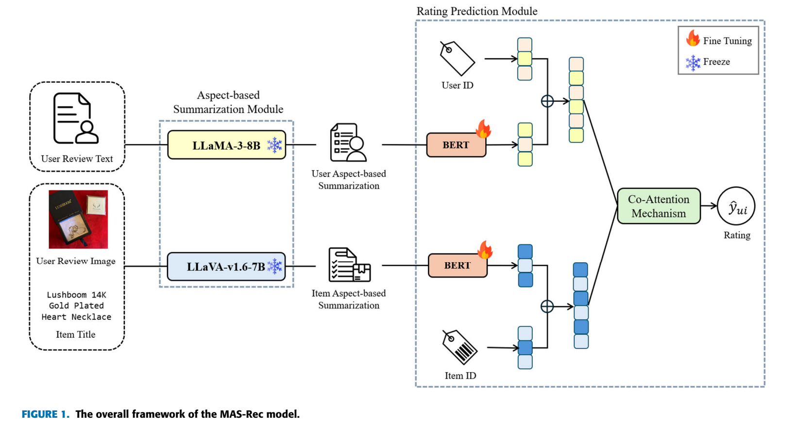
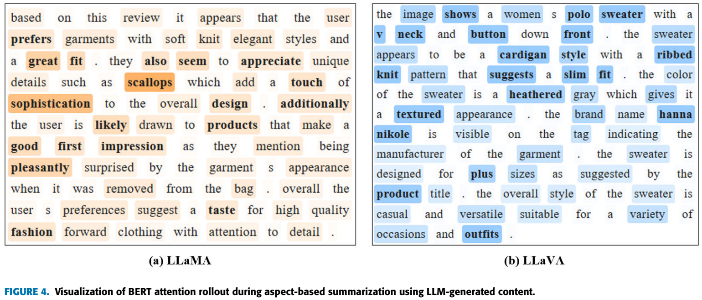

# MAS-Rec

MAS-Rec is a multimodal review-based recommendation framework designed to
improve rating prediction by deriving preference-relevant representations from
user-generated content (UGC). Online reviews describe purchase motivations,
emotional responses, and usage experiences, whereas review images provide
complementary visual evidence about product appearance and characteristics.
MAS-Rec converts these heterogeneous signals into attribute-aware textual
representations and learns their interaction for recommendation.

[한국어](README.md) · [Paper](https://doi.org/10.1109/ACCESS.2026.3694258) · [Data](data/README.md) · [Experiments](docs/EXPERIMENTS.md)

## Research motivation

Collaborative filtering and matrix factorization effectively model historical
interactions, but rating values alone provide limited evidence about why a user
preferred an item. Prior review-based and multimodal recommender systems have
therefore investigated UGC as an additional source for enriching user and item
representations. However, directly combining text and image features can retain
irrelevant information and preserve the structural differences between the two
modalities.

MAS-Rec addresses this issue by summarizing text and image UGC at the attribute
level. The resulting descriptions provide a common semantic space in which
user preferences and product characteristics can be compared more directly.

## Framework

1. **Text UGC representation:** LLaMA summarizes review text into
   preference-relevant attributes, including fit, style, quality, and
   durability.
2. **Image UGC representation:** LLaVA describes review images together with
   product titles using the same attribute-oriented format.
3. **Recommendation-oriented encoding:** BERT encodes the generated summaries
   and is fine-tuned for rating prediction.
4. **Cross-representation interaction:** A Co-Attention module models the
   semantic relationship between the user-side and item-side representations
   before predicting the final rating.

The framework employs existing large language models to transform UGC; it does
not introduce a newly pretrained language model.



## Contributions

- A unified textual representation is constructed from review text and images,
  thereby reducing the representational gap between modalities.
- Attribute-based summarization selects information that is more closely
  related to user preferences and product characteristics than unrestricted
  feature fusion.
- Recommendation-oriented BERT fine-tuning and Co-Attention jointly capture
  informative attributes and their user–item interactions.
- Experiments on two Amazon categories demonstrate consistent improvements
  over the compared recommendation methods.

## Data and experimental design

The prediction target is the 1–5 star rating associated with each Amazon
review. The filtered datasets used in the study are summarized below.

| Category | Reviews | Users | Items | Sparsity |
|---|---:|---:|---:|---:|
| Clothing, Shoes and Jewelry | 66,718 | 7,449 | 16,099 | 99.944% |
| Cell Phones and Accessories | 23,491 | 4,149 | 4,975 | 99.886% |

Each dataset is randomly divided into training, validation, and test sets using
a 70:10:20 ratio. Model selection is performed using validation performance,
and the final models are evaluated with MAE, MSE, RMSE, and MAPE. The public
baseline directory retains the representative NeuMF, CAMRec, and MMCN
notebooks used in the research workflow.

## Main results

The following values are reported in the paper; lower values indicate better
performance.

| Category | Best baseline RMSE | MAS-Rec RMSE | MAS-Rec MAE |
|---|---:|---:|---:|
| Clothing, Shoes and Jewelry | 0.549 (MMCN) | **0.507** | **0.316** |
| Cell Phones and Accessories | 0.621 (MMCN) | **0.527** | **0.299** |

The complete MAE, MSE, RMSE, and MAPE tables are provided in
[`results/metrics.csv`](results/metrics.csv) and
[`docs/EXPERIMENTS.md`](docs/EXPERIMENTS.md). The prompt comparison further
shows that the most effective summarization strategy can vary by domain:
reasoning-based summaries performed best for Clothing, whereas attribute-based
summaries performed best for Cell Phones.

## Interpretation and error analysis

Attention Rollout is used to inspect which expressions receive relatively high
attention after recommendation-oriented fine-tuning. Preference-related terms
such as *fit*, *style*, *color*, and *design* frequently receive high values.
This analysis is an inspection aid and should not be interpreted as a causal
explanation of an individual prediction.



The text error analysis additionally examines whether an LLM summary preserves
the review's attributes and sentiment. Sentiment reversal and the omission of
negative attributes are treated as candidates for manual inspection rather
than definitive evidence of hallucination. The complete aggregation tables,
figures, and manual review results are provided in
[`docs/TEXT_ERROR_ANALYSIS.md`](docs/TEXT_ERROR_ANALYSIS.md).

## Repository structure

```text
MAS-Rec/
├── notebooks/
│   ├── 00_preprocessing/    # Text and image feature preparation
│   ├── 01_summarization/    # LLaMA and LLaVA summarization
│   ├── 03_baselines/        # NeuMF, CAMRec, and MMCN
│   └── 04_experiments/      # Fusion, prompt, and attention analyses
├── configs/                 # Experiment and aspect-normalization settings
├── results/                 # Reported results and figures
├── data/                    # Data schema and column descriptions
├── docs/                    # Experiment, reproduction, and limitation notes
├── requirements.txt
└── CITATION.cff
```

## Notebook execution

```bash
pip install -r requirements.txt
```

The notebooks are written for Google Colab and Google Drive; verify the data
paths and runtime before execution. The CSV file under `data/sample/` is a
synthetic schema example and is not used to obtain the reported results. Full
data preparation and experiment order are described in
[`docs/REPRODUCIBILITY.md`](docs/REPRODUCIBILITY.md).

## Limitations

Generated summaries may omit relevant details or introduce unsupported
expressions. The experiments cover two Amazon product categories, and the same
performance is not guaranteed in other domains. Moreover, image-modality error
analysis remains limited because visual evidence cannot be assessed using the
same attribute-matching procedure as text. See
[`docs/LIMITATIONS.md`](docs/LIMITATIONS.md) for details.

## Citation and code use

Please cite the article specified in [`CITATION.cff`](CITATION.cff). The article
is distributed under CC BY 4.0. The repository does not currently include a
separate open-source software license; confirm the applicable code-use terms
with the repository owner before redistribution.
