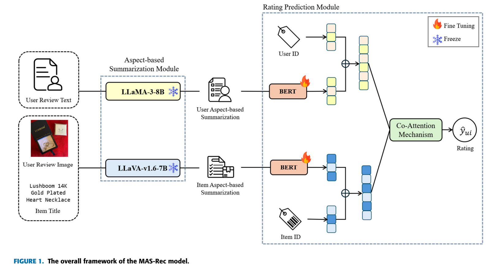
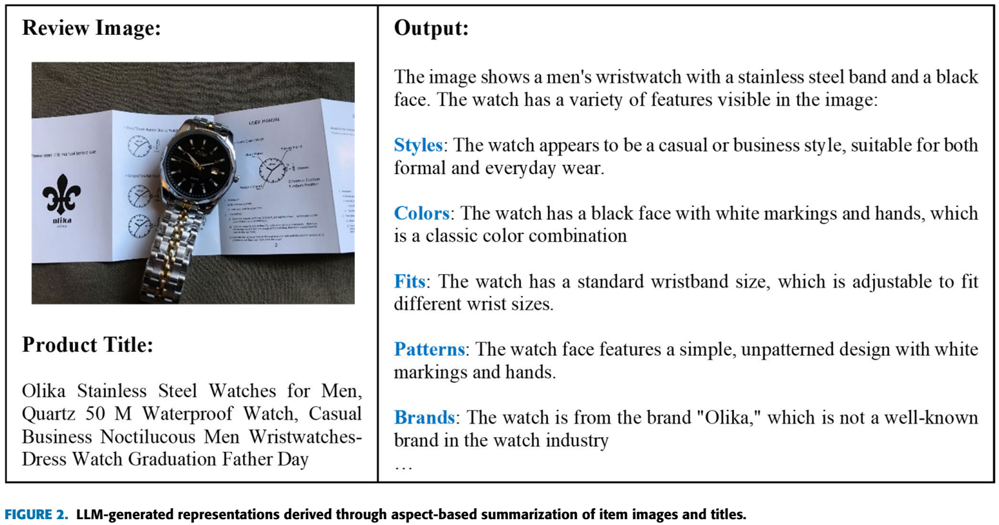
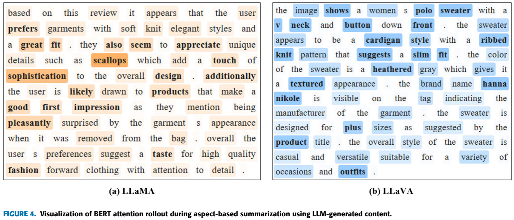

# MAS-Rec

**MAS-Rec(Multimodal Aspect Summarization for Recommender Systems)**의 연구 코드 저장소입니다. 리뷰 텍스트와 상품 이미지를 같은 속성 중심의 문장으로 변환한 뒤, 사용자와 상품의 선호 관계를 학습해 평점을 예측합니다.

> 현재 저장소는 비공개 연구·포트폴리오 용도로 정리했습니다. 대용량 전처리 데이터와 학습 체크포인트는 포함하지 않습니다.

[English README](README.md) · [논문](https://doi.org/10.1109/ACCESS.2026.3694258) · [데이터 안내](docs/DATA.md) · [실험 안내](docs/EXPERIMENTS.md)

## 연구 배경과 접근

기존 멀티모달 추천시스템은 리뷰와 이미지를 서로 다른 특징 공간에서 처리하기 때문에, 두 정보가 같은 상품 속성을 표현하더라도 의미를 직접 맞추기 어렵습니다. MAS-Rec은 리뷰에는 LLaMA-3-8B-Instruct를, 상품 제목과 이미지에는 LLaVA-1.6-Mistral-7B를 적용해 속성별 요약을 생성합니다. 이후 사용자와 상품 요약을 각각 BERT로 인코딩하고, ID 임베딩과 결합한 뒤 양방향 co-attention으로 상호작용을 학습합니다.



*그림 1. MAS-Rec의 전체 구조. 요약을 생성하는 LLM은 고정하고, 두 BERT 인코더는 평점 예측 손실을 통해 미세조정합니다.*

### 속성 중심의 멀티모달 표현

LLaVA는 상품 이미지와 제목을 바탕으로 스타일, 색상, 착용감, 패턴, 브랜드와 같은 속성을 문장으로 정리합니다. 이를 통해 시각 정보를 추천모델이 처리하는 자연어 표현과 같은 형태로 맞춥니다.



*그림 2. 리뷰 이미지와 상품 제목으로부터 생성한 상품 속성 표현의 예시.*

BERT는 고정된 특징 추출기로만 사용하지 않았습니다. 평점 예측 손실을 기준으로 전체 모델과 함께 미세조정해 추천 과업에 맞는 표현을 학습했습니다.

### 미세조정 결과의 해석

미세조정된 사용자·상품 BERT가 어떤 단어에 상대적으로 주목하는지 확인하기 위해 Attention Rollout을 적용했습니다. 그 결과 fit, style, knit, color, design처럼 선호와 상품 특성을 나타내는 표현에 높은 가중치가 형성되는 양상을 확인했습니다. 다만 이는 모델의 주목 경향을 살펴보는 보조 분석이며, 예측의 인과적 근거를 완전히 설명하는 것은 아닙니다.



*그림 4. LLM이 생성한 사용자·상품 요약문에 대한 BERT Attention Rollout 결과.*

## 주요 결과

논문에 보고된 MAS-Rec 성능입니다. 모든 지표는 낮을수록 좋습니다.

| 데이터셋 | MAE | MSE | RMSE | MAPE |
|---|---:|---:|---:|---:|
| Clothing, Shoes and Jewelry | **0.316** | **0.257** | **0.507** | **0.089** |
| Cell Phones and Accessories | **0.299** | **0.278** | **0.527** | **0.090** |

전체 베이스라인과 추가 실험 결과는 [docs/EXPERIMENTS.md](docs/EXPERIMENTS.md)에 정리했습니다.

## 저장소 구성

```text
notebooks/
├── 00_preprocessing/          # 데이터 필터링 및 기존 인코더 특징 생성
├── 01_summarization/          # 리뷰·이미지 속성 요약
├── 02_model/                  # 제안 모델 MAS-Rec
├── 03_baselines/              # 비교 모델 6종
└── 04_experiments/            # 융합 방식·프롬프트·Attention 분석
```

노트북의 실행 결과와 개인 실행환경 정보는 제거했습니다. 원본 연구가 Google Colab과 Google Drive에서 진행되어 일부 셀에는 `/content/drive/MyDrive/...` 경로가 남아 있습니다. 실행 전 자신의 데이터 경로에 맞게 바꿔야 하며, 자세한 내용은 [재현 안내](docs/REPRODUCIBILITY.md)를 참고해 주세요.

## 실행 순서

1. `requirements.txt`의 패키지를 설치합니다.
2. [데이터 안내](docs/DATA.md)에 따라 로컬에 데이터를 준비합니다.
3. `00_preprocessing` → `01_summarization` → `02_model` 순서로 실행합니다.
4. 비교 실험은 `03_baselines`, 추가 분석은 `04_experiments`에서 실행합니다.

LLaMA·LLaVA 사용 시 Hugging Face 권한이 필요할 수 있습니다. 토큰은 `HF_TOKEN` 환경변수 또는 노트북의 비공개 입력창으로만 전달하고, 코드나 노트북에 직접 저장하지 마세요.

## 데이터 규모

| 데이터셋 | 리뷰 | 사용자 | 상품 | 희소성 |
|---|---:|---:|---:|---:|
| Clothing, Shoes and Jewelry | 66,718 | 7,449 | 16,099 | 99.944% |
| Cell Phones and Accessories | 23,491 | 4,149 | 4,975 | 99.886% |

전처리 파일은 개별 파일 기준 약 63MB에서 2.98GB까지이므로 Git에 포함하지 않았습니다.

## 논문 정보

- Soohyun Woo, Seonu Park, Xinzhe Li, Seongkook Lee, Jaekyeong Kim
- *Enhancing Multimodal Recommender System Performance Using Large Language Models*
- IEEE Access, Vol. 14, pp. 75498–75514, 2026
- DOI: [10.1109/ACCESS.2026.3694258](https://doi.org/10.1109/ACCESS.2026.3694258)

논문은 CC BY 4.0으로 공개되어 있습니다. 다만 이 코드 저장소에는 아직 별도의 오픈소스 라이선스를 부여하지 않았으므로, 구현을 재사용하거나 재배포하려면 저장소 소유자에게 먼저 문의해 주세요.
