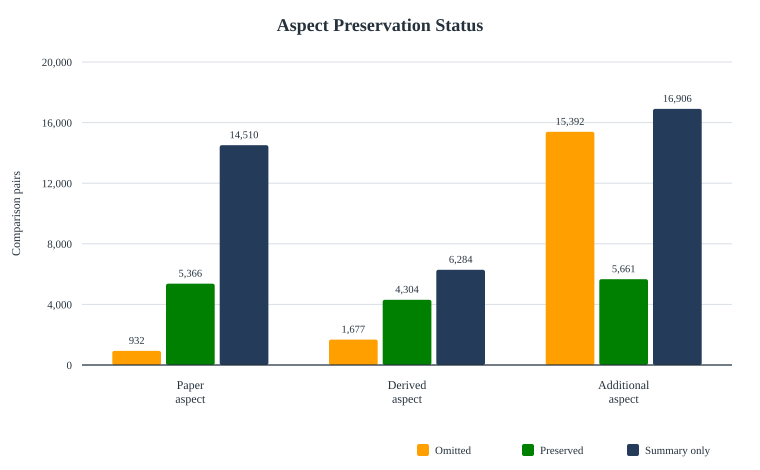
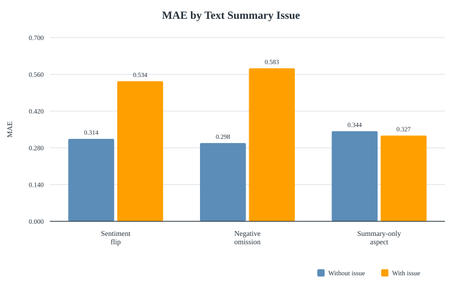
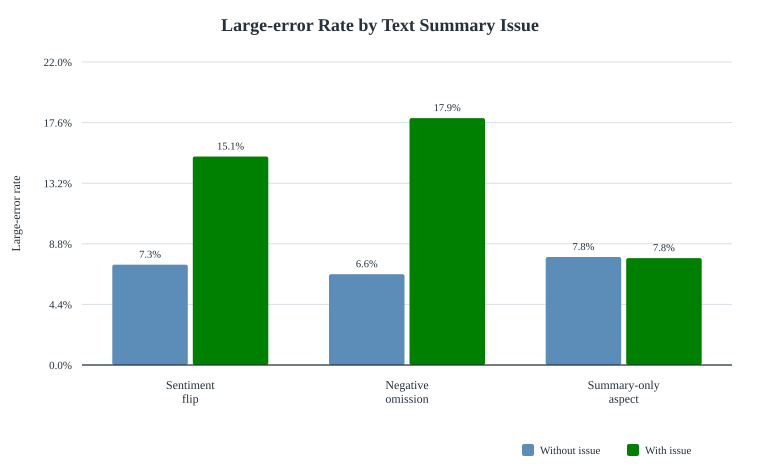
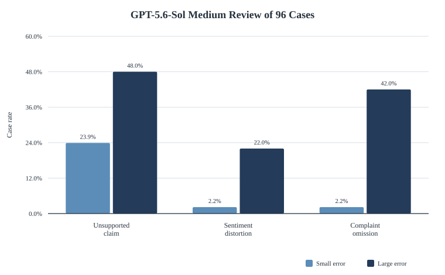

# 텍스트 요약 오류 분석

## 1. 분석 목적

본 분석은 원본 리뷰와 LLaMA 요약문에서 추출된 속성과 감성 방향을 비교하여, 요약
과정에서 발생하는 의미 변화가 추천 성능과 어떠한 관련성을 가지는지 확인하는 데
목적이 있다. 특히 원문의 감성이 반대로 전달되는 경우와 부정적 속성이 요약문에서
누락되는 경우를 구분하고, 각 오류의 발생 여부에 따른 평점 예측 오차를 비교하였다.

분석 범위는 텍스트 모달리티로 한정하였다. 이미지 요약은 원본 이미지와 생성 문장
사이의 감성 반전이나 정보 누락을 텍스트와 동일한 기준으로 판단하기 어려우므로 본
분석에서 제외하였다. 또한 자동 분석 결과는 환각의 확정 판정이 아니라 수동 검토가
필요한 후보를 선별하는 데 사용하였다.

## 2. 분석 데이터와 연결 기준

평점 예측 결과에 저장된 `source_index`를 이용하여 원본 리뷰, LLaMA 요약문, 실제
평점 및 예측값을 연결하였다. 전체 테스트 예측 13,344건이 원본 리뷰와 모두
연결되었으며, 테스트 데이터의 평균 절대오차는 0.3278로 나타났다.

| 데이터 | 사례 수 |
|---|---:|
| 전체 원본 리뷰 | 66,718 |
| 테스트 예측 | 13,344 |
| 원문 연결 완료 | 13,344 |

| 항목 | 평균 | 표준편차 | 최솟값 | 최댓값 |
|---|---:|---:|---:|---:|
| 실제 평점 | 4.5891 | 0.7315 | 1.0000 | 5.0000 |
| 예측 평점 | 4.6516 | 0.6454 | 1.0543 | 5.2911 |
| 절대오차 | 0.3278 | 0.3987 | 0.0000 | 3.7074 |

## 3. 속성 추출과 정규화

원본 리뷰와 요약문의 속성 및 감성은 PyABSA ATEPC multilingual 모델로 추출하였다.
감성 라벨은 부정 -1, 중립 0, 긍정 1로 변환하였으며, 속성 추출 시 함께 생성된
신뢰도를 유지하였다. 별도의 감성 모델을 추가로 적용하지 않아 추출 속성과 감성
라벨의 대응 관계를 보존하였다.

논문에서 사용한 `style`, `color`, `fit`, `pattern`, `brand`는 Paper aspect로
구분하였다. `quality`, `comfort`, `material`, `durability`, `value`는 분석 과정에서
정리한 Derived aspect이며, 규칙에 포함되지 않은 표현은 삭제하지 않고 Additional
aspect로 보존하였다. 예를 들어 `style`, `design`, `look`, `appearance`, `fashion`은
모두 `style`로 통합하였다.

`aspect_pair_df`의 한 행은 동일한 `source_index`와 정규화된 `aspect`로 구성된 하나의
비교 단위이다. 따라서 아래 표의 비교 건수는 단순 단어 빈도가 아니라 원문과 요약문의
속성 대응 관계를 나타낸다.

| 속성 유형 | 고유 속성 수 | 원문 출현 | 요약문 출현 | 비교 쌍 | 누락 | 보존 | 요약문 단독 |
|---|---:|---:|---:|---:|---:|---:|---:|
| Paper aspect | 5 | 6,298 | 19,876 | 20,808 | 932 | 5,366 | 14,510 |
| Derived aspect | 5 | 5,981 | 10,588 | 12,265 | 1,677 | 4,304 | 6,284 |
| Additional aspect | 8,398 | 21,053 | 22,567 | 37,959 | 15,392 | 5,661 | 16,906 |

Additional aspect는 8,398개의 서로 다른 표현을 포함하므로 Paper aspect 및 Derived
aspect와 절대 건수를 직접 비교하기 어렵다. 다만 추가 속성에서 원문에만 남은 사례가
15,392건으로 나타난 결과는, 규칙에 포함되지 않은 세부 경험이나 제품 표현이 요약
과정에서 충분히 보존되지 않았을 가능성을 보여준다.

### 논문 속성별 집계

| 속성 | 원문 출현 | 요약문 출현 | 비교 쌍 | 누락 | 보존 | 요약문 단독 |
|---|---:|---:|---:|---:|---:|---:|
| style | 1,525 | 8,608 | 8,752 | 144 | 1,381 | 7,227 |
| fit | 3,006 | 6,594 | 6,974 | 380 | 2,626 | 3,968 |
| color | 1,477 | 3,302 | 3,623 | 321 | 1,156 | 2,146 |
| pattern | 282 | 1,301 | 1,382 | 81 | 201 | 1,100 |
| brand | 8 | 71 | 77 | 6 | 2 | 69 |

Paper aspect 중 원문에서는 `fit`이 가장 많이 추출되었으며, 요약문에서는 `style`의
출현이 가장 많았다. 이는 LLaMA 요약이 구체적인 제품 표현을 스타일 관련 표현으로
확장하여 서술하는 경향이 있음을 보여준다. 다만 요약문 단독 속성에는 의미가 같은
표현의 매칭 실패도 포함될 수 있으므로 정보 추가나 환각으로 단정할 수 없다.

### 파생 속성별 집계

| 속성 | 원문 출현 | 요약문 출현 | 비교 쌍 | 누락 | 보존 | 요약문 단독 |
|---|---:|---:|---:|---:|---:|---:|
| material | 2,459 | 3,802 | 4,207 | 405 | 2,054 | 1,748 |
| quality | 1,177 | 2,841 | 3,352 | 511 | 666 | 2,175 |
| value | 1,289 | 1,454 | 1,893 | 439 | 850 | 604 |
| durability | 946 | 1,356 | 1,625 | 269 | 677 | 679 |
| comfort | 110 | 1,135 | 1,188 | 53 | 57 | 1,078 |

Derived aspect에서는 `material`의 보존 건수가 2,054건으로 가장 많았다. 반면
`comfort`는 원문 출현이 110건에 불과하지만 요약문에서는 1,135건으로 증가하였다.
이는 원문의 다양한 표현이 `comfort`로 일반화되었거나 요약 과정에서 편안함에 관한
해석이 추가되었을 가능성을 함께 포함한다.

## 4. 텍스트 오류와 평점 예측 오차

감성 반전은 원문과 요약문에 모두 보존된 속성의 감성이 긍정에서 부정 또는 부정에서
긍정으로 변한 경우로 정의하였다. 부정 속성 누락은 원문에서 부정으로 판정된 속성이
요약문에서 사라진 경우이며, 요약문 단독 속성은 요약문에서만 확인된 속성이 하나 이상
존재하는 경우이다.

| 오류 유형 | 오류 없음 사례 | 오류 없음 MAE | 오류 있음 사례 | 오류 있음 MAE | 오류 없음 큰 오차율 | 오류 있음 큰 오차율 |
|---|---:|---:|---:|---:|---:|---:|
| 감성 반전 | 12,525 | 0.3143 | 819 | 0.5337 | 7.28% | 15.14% |
| 부정 속성 누락 | 11,961 | 0.2983 | 1,383 | 0.5831 | 6.59% | 17.93% |
| 요약문 단독 속성 | 625 | 0.3436 | 12,719 | 0.3270 | 7.84% | 7.76% |

감성 반전이 존재한 사례의 MAE는 0.5337로, 해당 문제가 없는 사례의 0.3143보다
높았다. 큰 오차 비율도 7.28%에서 15.14%로 증가하였다. 부정 속성 누락이 존재한
사례의 MAE는 0.5831로 가장 높았으며, 큰 오차 비율은 17.93%로 나타났다. 이는
요약문에서 감성 방향이 변경되거나 사용자의 핵심 불만이 제거되는 현상이 높은 추천
오차와 관련될 가능성을 보여준다.

반면 요약문 단독 속성은 발생 여부에 따른 MAE와 큰 오차 비율의 차이가 뚜렷하지
않았다. 요약문 단독 속성에는 실제 정보 추가뿐 아니라 동일한 의미를 가진 서로 다른
표현도 포함되므로, 단독 속성의 존재만으로 추천 성능 저하를 설명하기는 어렵다.

오차 크기에 따라 사례를 구분한 결과도 같은 경향을 보였다.

| 오차 집단 | 사례 수 | MAE | 감성 반전 비율 | 부정 속성 누락 비율 | 요약문 단독 속성 비율 |
|---|---:|---:|---:|---:|---:|
| 큰 오류 | 1,036 | 1.3230 | 11.97% | 23.94% | 95.27% |
| 중간 오류 | 3,768 | 0.5795 | 11.52% | 18.39% | 95.22% |
| 작은 오류 | 8,540 | 0.0960 | 3.06% | 5.18% | 95.36% |

큰 오류군에서는 작은 오류군보다 감성 반전과 부정 속성 누락이 빈번하게 나타났다.
그러나 요약문 단독 속성 비율은 세 집단에서 모두 약 95%로 유사하게 나타나, 해당
지표가 오차 크기를 구분하는 데에는 제한적인 것으로 확인되었다.

## 5. GPT-5.6-Sol Medium 기반 사례 판정

자동 분석 결과를 보완하기 위하여 절대오차 1.0 이상인 큰 오류 사례 50건과 절대오차
0.25 이하인 작은 오류 사례 46건을 추출하였다. GPT-5.6-Sol Medium이 96개의 원문
리뷰와 LLaMA 요약문을 개별적으로 비교하여 각 오류 항목을 1차 판정하였다. 평점별
대응 표본을 구성하였으나 평점 1의 작은 오류 후보가 부족하여 최종 분석 대상은
96건으로 확정하였다.

모델 판정 항목은 원문에 없는 구체적 내용이 추가된 `근거 없는 주장`, 원문의 감성이나
속성 평가가 반대로 전달된 `감성 왜곡`, 핵심 불만이 제거되거나 약화된 `불만 누락`으로
구성하였다. 한 사례에서 여러 오류가 동시에 발생할 수 있으므로 오류 건수의 합은 전체
사례 수와 일치하지 않는다. 해당 결과는 연구자의 독립적인 수동 판정이 아니라
GPT-5.6-Sol Medium을 이용한 보조적 1차 판정이며, 경계 사례에는 추가적인 연구자
검토가 필요하다.

> **용어 구분:** 감성 반전(Sentiment flip)은 동일한 속성에 대한 PyABSA 감성 라벨이
> 긍정에서 부정 또는 부정에서 긍정으로 바뀐 경우를 코드로 판정한 결과이다. 감성
> 왜곡(Sentiment distortion)은 GPT-5.6-Sol Medium이 원문과 요약문을 직접 비교하여
> 감성 방향의 반전뿐 아니라 부정 표현의 약화와 과도한 긍정화를 포함해 판정한
> 결과이다. 따라서 감성 반전은 감성 왜곡의 일부에 해당할 수 있으나 두 지표는
> 동일하지 않다.

| 표본 | 사례 수 | 근거 없는 주장 | 감성 왜곡 | 불만 누락 | 하나 이상 해당 | MAE |
|---|---:|---:|---:|---:|---:|---:|
| 큰 오류 | 50 | 24 (48.0%) | 11 (22.0%) | 21 (42.0%) | 27 | 2.5280 |
| 작은 오류 | 46 | 11 (23.9%) | 1 (2.2%) | 1 (2.2%) | 11 | 0.1345 |
| 전체 | 96 | 35 | 12 | 22 | 38 | - |

큰 오류군에서는 감성 왜곡과 불만 누락이 작은 오류군보다 현저히 많이 확인되었다.
근거 없는 주장도 큰 오류군에서 더 높은 비율을 보였으나 작은 오류군에서도 11건이
확인되었다. 따라서 요약문에 원문 근거가 부족한 표현이 존재한다는 사실만으로 높은
예측 오차를 설명하기는 어렵고, 감성 방향과 부정적 선호 정보의 보존 여부를 함께
검토할 필요가 있다.

## 6. 종합 결과

분석 결과, 원본 리뷰의 속성별 감성이 요약문에서 반대로 변하거나 부정적 속성이
누락된 사례에서 MAE와 큰 오차 비율이 상대적으로 높게 나타났다. GPT-5.6-Sol Medium
기반 사례 판정에서도 큰 오류군의 감성 왜곡과 불만 누락 비율이 작은 오류군보다 높게
확인되어 자동 분석과 일관된 경향을 보였다. 이는 LLM 요약의 품질을 단순 속성
개수만으로 평가하기보다, 사용자의 감성 방향과 핵심 불만이 유지되는지를 함께
평가해야 함을 시사한다.

요약문에만 나타난 속성은 대부분의 테스트 사례에서 확인되었으나 추천 오차와의 뚜렷한
관계는 나타나지 않았다. 따라서 요약문 단독 속성은 환각으로 확정하기보다 표현 차이,
일반화 및 정보 추가 가능성을 포함한 수동 검토 후보로 활용하는 것이 적절하다. 본
결과는 텍스트 요약 오류와 예측 오차 사이의 연관성을 보여주는 것이며 직접적인
인과관계를 입증하지 않는다.

## 7. 한계

첫째, 본 분석은 텍스트 모달리티만을 대상으로 하여 LLaVA 이미지 요약의 오류와 추천
성능 간의 관계를 동일한 기준으로 검증하지 못하였다. 둘째, 규칙 기반 속성 정규화로
인해 의미가 같은 서로 다른 표현이 별도의 속성으로 분류되었을 가능성이 있다. 셋째,
감성 반전은 긍정과 부정의 직접적인 전환만 포함하므로 중립 감성과 관련된 변화를
충분히 반영하지 못하였다. 넷째, GPT-5.6-Sol Medium 기반 판정은 96개 표본을
대상으로 수행되었으며 연구자 간 일치도나 독립적인 사람 평가를 포함하지 않아 전체
테스트 데이터로 일반화하는 데 한계가 있다. 마지막으로 자동 판정과 모델 기반 사례
판정 모두 텍스트 오류와 예측 오차의 연관성을 평가하며, 오류가 예측 성능 저하를 직접
유발했음을 증명하지는 않는다.

## 관련 파일

- 분석 노트북: [`notebooks/05_text_error_analysis.ipynb`](../notebooks/05_text_error_analysis.ipynb)
- 시각화 결과: [`results/figures/`](../results/figures/)
