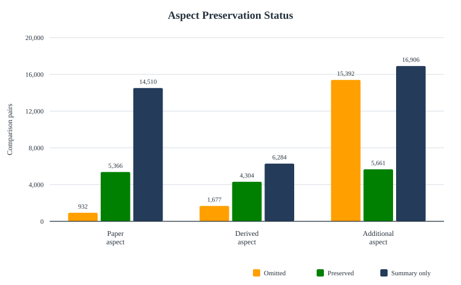
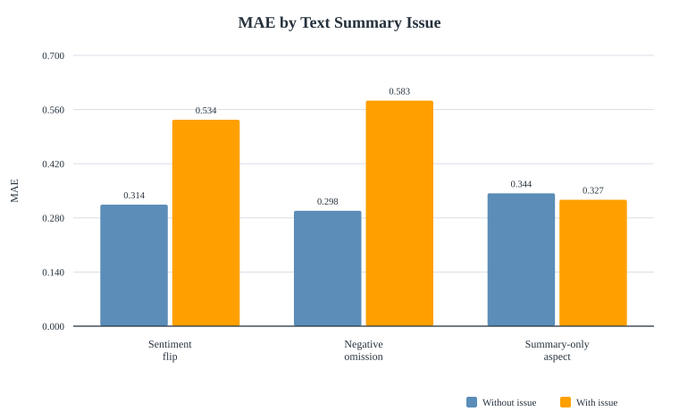
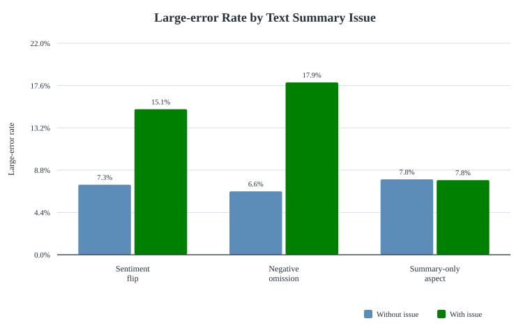
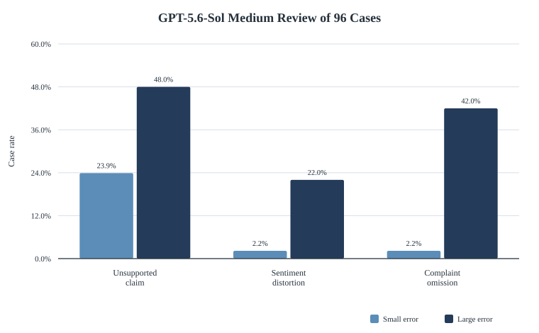

# Text Summary Error Analysis

[한국어](TEXT_ERROR_ANALYSIS.md)

## 1. Objective

This analysis examines whether semantic changes introduced during LLaMA-based
review summarization are associated with rating-prediction errors. Attributes
and sentiment directions extracted from the original reviews are compared with
those extracted from the summaries. Particular attention is given to sentiment
reversal and the omission of negative attributes, because these changes can
alter the representation of user preferences and complaints.

The analysis is restricted to the text modality. Image summaries are excluded
because unsupported visual claims, sentiment changes, and information omission
cannot be evaluated using the same text-matching procedure. Automated results
are used to identify candidates for further inspection and are not treated as
definitive evidence of hallucination.

## 2. Data alignment

The `source_index` stored with each prediction is used to align the original
review, the LLaMA summary, the observed rating, and the predicted rating. All
13,344 test predictions were successfully matched with their source reviews.
The mean absolute error of the aligned test set was 0.3278.

| Data | Number of cases |
|---|---:|
| Full source data | 66,718 |
| Test predictions | 13,344 |
| Successfully matched reviews | 13,344 |

| Measure | Mean | Standard deviation | Minimum | Maximum |
|---|---:|---:|---:|---:|
| Observed rating | 4.5891 | 0.7315 | 1.0000 | 5.0000 |
| Predicted rating | 4.6516 | 0.6454 | 1.0543 | 5.2911 |
| Absolute error | 0.3278 | 0.3987 | 0.0000 | 3.7074 |

## 3. Aspect extraction and normalization

Aspects and their sentiment labels are extracted from the original reviews and
LLaMA summaries using the PyABSA ATEPC multilingual model. The sentiment labels
are mapped to -1 for negative, 0 for neutral, and 1 for positive. Confidence
scores generated during aspect extraction are retained, which preserves the
correspondence between each extracted aspect and its sentiment label without
introducing a separate sentiment model.

The paper-defined aspects—`style`, `color`, `fit`, `pattern`, and `brand`—are
classified as Paper aspects. The analysis additionally normalizes `quality`,
`comfort`, `material`, `durability`, and `value` as Derived aspects. Expressions
not covered by these rules are retained as Additional aspects. For example,
`style`, `design`, `look`, `appearance`, and `fashion` are mapped to `style`.

Each row of `aspect_pair_df` represents one comparison unit defined by a common
`source_index` and normalized `aspect`. The following counts therefore describe
review-summary aspect pairs rather than raw token frequencies.

| Aspect type | Unique aspects | Review occurrences | Summary occurrences | Comparison pairs | Omitted | Preserved | Summary only |
|---|---:|---:|---:|---:|---:|---:|---:|
| Paper aspect | 5 | 6,298 | 19,876 | 20,808 | 932 | 5,366 | 14,510 |
| Derived aspect | 5 | 5,981 | 10,588 | 12,265 | 1,677 | 4,304 | 6,284 |
| Additional aspect | 8,398 | 21,053 | 22,567 | 37,959 | 15,392 | 5,661 | 16,906 |

Additional aspects include 8,398 distinct expressions and are therefore not
directly comparable with the two five-category groups in terms of absolute
counts. Nevertheless, the 15,392 omitted Additional-aspect pairs indicate that
detailed user experiences or product-specific expressions outside the
normalization rules may not be fully preserved during summarization.

### Paper aspects

| Aspect | Review occurrences | Summary occurrences | Comparison pairs | Omitted | Preserved | Summary only |
|---|---:|---:|---:|---:|---:|---:|
| style | 1,525 | 8,608 | 8,752 | 144 | 1,381 | 7,227 |
| fit | 3,006 | 6,594 | 6,974 | 380 | 2,626 | 3,968 |
| color | 1,477 | 3,302 | 3,623 | 321 | 1,156 | 2,146 |
| pattern | 282 | 1,301 | 1,382 | 81 | 201 | 1,100 |
| brand | 8 | 71 | 77 | 6 | 2 | 69 |

`fit` was the most frequent Paper aspect in the original reviews, whereas
`style` was the most frequent aspect in the summaries. This pattern suggests
that LLaMA tends to expand product-specific expressions into style-related
descriptions. Summary-only aspects, however, may also reflect unmatched
synonyms and should not be classified as hallucinations without contextual
inspection.

### Derived aspects

| Aspect | Review occurrences | Summary occurrences | Comparison pairs | Omitted | Preserved | Summary only |
|---|---:|---:|---:|---:|---:|---:|
| material | 2,459 | 3,802 | 4,207 | 405 | 2,054 | 1,748 |
| quality | 1,177 | 2,841 | 3,352 | 511 | 666 | 2,175 |
| value | 1,289 | 1,454 | 1,893 | 439 | 850 | 604 |
| durability | 946 | 1,356 | 1,625 | 269 | 677 | 679 |
| comfort | 110 | 1,135 | 1,188 | 53 | 57 | 1,078 |

`material` exhibited the largest number of preserved Derived-aspect pairs. In
contrast, `comfort` occurred in only 110 original-review pairs but in 1,135
summary pairs. This increase may reflect both the normalization of diverse
expressions into a general comfort concept and additional interpretation by the
summarization model.

## 4. Relationship between text-summary issues and prediction errors

A sentiment flip is defined as a positive-to-negative or
negative-to-positive transition for an aspect preserved in both texts. A
negative omission occurs when an aspect labeled as negative in the original
review is absent from the summary. A summary-only aspect indicates that at
least one aspect is detected only in the summary.

| Issue | Cases without issue | MAE without issue | Cases with issue | MAE with issue | Large-error rate without issue | Large-error rate with issue |
|---|---:|---:|---:|---:|---:|---:|
| Sentiment flip | 12,525 | 0.3143 | 819 | 0.5337 | 7.28% | 15.14% |
| Negative-aspect omission | 11,961 | 0.2983 | 1,383 | 0.5831 | 6.59% | 17.93% |
| Summary-only aspect | 625 | 0.3436 | 12,719 | 0.3270 | 7.84% | 7.76% |

Cases containing a sentiment flip exhibited an MAE of 0.5337, compared with
0.3143 for cases without a flip. Their large-error rate also increased from
7.28% to 15.14%. Negative-aspect omission produced the largest MAE of 0.5831
and a large-error rate of 17.93%. These results indicate that changes in
sentiment direction and the removal of user complaints are associated with
larger recommendation errors.

In contrast, the presence of summary-only aspects did not produce a meaningful
difference in either MAE or large-error rate. Because this category includes
lexical variation, generalization, and potentially unsupported additions, its
presence alone is insufficient to explain prediction degradation.

The same pattern is observed when cases are grouped by error magnitude.

| Error group | Cases | MAE | Sentiment-flip rate | Negative-omission rate | Summary-only rate |
|---|---:|---:|---:|---:|---:|
| Large error | 1,036 | 1.3230 | 11.97% | 23.94% | 95.27% |
| Middle error | 3,768 | 0.5795 | 11.52% | 18.39% | 95.22% |
| Small error | 8,540 | 0.0960 | 3.06% | 5.18% | 95.36% |

Sentiment flips and negative omissions were more frequent in the large-error
group than in the small-error group. The summary-only rate remained close to
95% in all three groups and consequently provided limited discrimination
between error levels.

## 5. GPT-5.6-Sol Medium-assisted case assessment

To complement the automatic analysis, 50 large-error cases with an absolute
error of at least 1.0 and 46 small-error cases with an absolute error of at
most 0.25 were selected. GPT-5.6-Sol Medium compared each of the 96 original
reviews with its LLaMA summary and performed a first-pass assessment. The final
sample contains 96 rather than 100 cases because an insufficient number of
small-error candidates was available for rating 1.

The assessment considered three non-exclusive categories: an unsupported claim
that adds specific information not grounded in the review; sentiment
distortion that reverses or weakens the original evaluation; and complaint
omission that removes or attenuates a central negative statement. Because
multiple categories can be assigned to one case, their counts do not sum to
the number of reviewed cases. This is a model-assisted first-pass assessment,
not an independent human annotation, and borderline cases require additional
researcher review.

> **Terminology:** A sentiment flip is an automatic rule-based result in which
> the PyABSA label for the same aspect changes directly from positive to
> negative or from negative to positive. Sentiment distortion is determined by
> GPT-5.6-Sol Medium through a contextual comparison of the full review and
> summary. It includes direct reversal, attenuation of negative statements,
> and excessive positive reframing. A sentiment flip can therefore be a subset
> of sentiment distortion, but the two measures are not identical.

| Group | Cases | Unsupported claim | Sentiment distortion | Complaint omission | At least one issue | MAE |
|---|---:|---:|---:|---:|---:|---:|
| Large error | 50 | 24 (48.0%) | 11 (22.0%) | 21 (42.0%) | 27 | 2.5280 |
| Small error | 46 | 11 (23.9%) | 1 (2.2%) | 1 (2.2%) | 11 | 0.1345 |
| Total | 96 | 35 | 12 | 22 | 38 | - |

Sentiment distortion and complaint omission occurred substantially more often
in the large-error group. Unsupported claims were also more frequent in this
group, but 11 instances were identified among the small-error cases. An
unsupported statement alone therefore does not fully explain a large
prediction error; sentiment direction and the preservation of negative
preference information should be considered jointly.

## 6. Summary

Sentiment reversal and negative-aspect omission were associated with higher MAE
and larger-error rates. The GPT-5.6-Sol Medium-assisted assessment exhibited a
consistent pattern: sentiment distortion and complaint omission were more
frequent among large-error cases than among small-error cases. These results
suggest that LLM summary quality should be evaluated not only by the number of
retained aspects but also by whether the direction of user sentiment and core
complaints are preserved.

Summary-only aspects were highly prevalent but were not clearly associated
with prediction errors. They should therefore be treated as candidates for
contextual review rather than as confirmed hallucinations. The reported
relationships are associative and do not establish that a summary error
directly caused a rating-prediction error.

## 7. Limitations

First, the analysis covers only the text modality and does not evaluate LLaVA
image descriptions using an equivalent procedure. Second, rule-based aspect
normalization may classify semantically equivalent expressions as different
aspects. Third, the sentiment-flip definition excludes transitions involving a
neutral label. Fourth, the GPT-5.6-Sol Medium-assisted assessment covers only
96 cases and does not include inter-annotator agreement or an independent human
evaluation. Finally, both the automatic and model-assisted analyses establish
associations rather than causal effects.

## Related file

- Analysis notebook: [`notebooks/05_text_error_analysis.ipynb`](../notebooks/05_text_error_analysis.ipynb)
- Figures: [`results/figures/`](../results/figures/)
